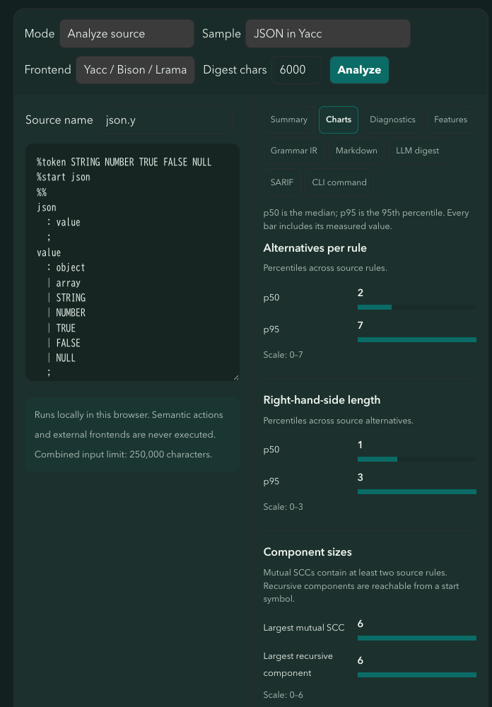

<div align="center">

# gramin

**Structural analysis for parser grammars.**

Turn grammar files into deterministic facts you can explore, review, and automate — without
executing semantic actions.

[](https://www.npmjs.com/package/@gramin/cli)
[](https://github.com/ydah/gramin/actions/workflows/ci.yml)
[](LICENSE)

[Product site](https://ydah.github.io/gramin/) · [Try the browser sandbox](https://ydah.github.io/gramin/sandbox) · [Documentation](https://ydah.github.io/gramin/guide/getting-started)

</div>

gramin normalizes Yacc, BNF, ANTLR4, Menhir, and PEG grammars into a common, versioned
Grammar IR. A deterministic analyzer then derives structural features and renders them as
JSON, CSV, Markdown, bounded LLM digests, or SARIF.

It is a grammar analysis toolkit — not a parser generator and not a language-correctness
proof. Its job is to make grammar structure visible before you change it.

[](https://ydah.github.io/gramin/sandbox)

## Try in 30 seconds

Open the [sandbox with runnable samples](https://ydah.github.io/gramin/sandbox), or
measure your own grammar with Node.js 22.12.0 or newer:

```sh
npx --yes @gramin/cli analyze grammar.y --format md
```

Explore the [Grammar Atlas](https://ydah.github.io/gramin/atlas/) for downloadable
JSON/CSV and the [Ruby parse.y chronicle](https://ydah.github.io/gramin/atlas/ruby-history).

## Why gramin?

| Use it to | What you get |
| --- | --- |
| **Explore** | Rules, alternatives, dependencies, recursion, reachability, diagnostics, and more |
| **Review** | Human-readable reports and before/after feature diffs for pull requests |
| **Automate** | Baselines, regression gates, and SARIF for GitHub Code Scanning |
| **Extend** | A JSON-Schema-backed IR and an external frontend protocol for custom tooling |

The analysis pipeline is intentionally small and explicit:

```text
grammar source → format frontend → Grammar IR → analyzer → JSON · Markdown · LLM · SARIF
```

## Key features

### One analysis boundary for many formats

Format-specific frontends stop at a versioned Grammar IR contract. Everything after that
boundary — analysis, comparison, and reporting — uses the same representation.

### Deterministic structural facts

Given the same source bytes, source identity, frontend, and options, gramin is designed to
produce byte-stable canonical output. Metrics are defined explicitly, and unsupported or
lossy constructs are reported as diagnostics instead of being silently treated as zero.

### Reports for people and tools

Start with Markdown for a review, JSON for scripts and snapshots, SARIF for Code Scanning, or
a bounded LLM digest for an assistant you control. Every renderer consumes the same validated
feature document.

### Safe by boundary

Semantic actions, target-language code, and predicates are never executed or retained in the
Grammar IR. The browser sandbox runs locally in a Web Worker and does not upload grammar
contents.

## Supported formats

| Format | Frontend ID | Notes |
| --- | --- | --- |
| POSIX Yacc, Bison, Lrama | `yacc-family` | Includes split parser/lexer inputs and supported named references |
| BNF, EBNF | `bnf` | Preserves EBNF sugar and reports unsupported or lossy syntax |
| ANTLR4 | `antlr4` | Supports parser, lexer, and split grammar files |
| Menhir | `menhir` | Includes supported parameterized rules and standard-library calls |
| Peggy, PEG.js | `peggy` | Preserves ordered-choice and scannerless capability context |

Use `gramin detect` to inspect candidates. When detection is ambiguous, pass `--frontend`
explicitly; gramin never silently chooses between tied formats.

See the [complete support matrix](https://ydah.github.io/gramin/formats/) and
[known limitations](docs/known-limitations.md) before interpreting a result.

## Usage

### Quick start

Requires Node.js 22.12.0 or newer.

Run without installing:

```sh
npx @gramin/cli analyze grammar.y
npx @gramin/cli analyze grammar.y --format md
```

Install the command globally when using it repeatedly:

```sh
npm install --global @gramin/cli
gramin analyze grammar.y --format md
```

Select a frontend explicitly when needed:

```sh
gramin analyze grammar.y --frontend yacc-family
gramin analyze Json.g4 --frontend antlr4
```

### Choose an output

| Format | Best for | Example |
| --- | --- | --- |
| `json` | Dashboards, scripts, and snapshots | `gramin analyze grammar.y --format json` |
| `md` | Pull-request review and reports | `gramin analyze grammar.y --format md` |
| `llm` | Bounded context for an assistant you control | `gramin analyze grammar.y --format llm --budget-chars 8000` |
| `sarif` | GitHub Code Scanning and CI annotations | `gramin analyze grammar.y --format sarif` |

Write a report to a file with `-o`:

```sh
gramin analyze grammar.y --format md -o grammar-report.md
gramin analyze grammar.y --format sarif -o gramin.sarif
```

### Compare changes and enforce a baseline

Compare two grammar files directly:

```sh
gramin diff base.y changed.y --format md
```

Use a checked-in feature document as a baseline and fail when tracked regressions are found:

```sh
gramin analyze changed.y \
  --baseline base.features.json \
  --fail-on-regression \
  --format md
```

The baseline and current run should use the same frontend selection and source identity policy.
Do not reduce a grammar to one universal “complexity score”: metric comparability depends on
the grammar representation and the capabilities available to the frontend.

Canonical LR(0) state construction is opt-in because it is more expensive:

```sh
gramin analyze grammar.y --analysis lr
```

### Inspect the Grammar IR

Grammar IR is a versioned, machine-readable boundary for caching, validation, and custom
tooling:

```sh
gramin ir grammar.y > grammar-ir.json
gramin validate-ir grammar-ir.json
gramin analyze --ir grammar-ir.json --format json
```

Use `--source-name <name>` for a single input or `--source-root <dir>` for byte-stable
multi-file output. Parser nesting defaults to 256 levels and supports a maximum of 256.
Use `--max-nesting-depth` to set a lower project-specific limit.

## GitHub Actions

The repository ships a composite action that emits SARIF for GitHub Code Scanning:

```yaml
name: Grammar analysis

on:
  pull_request:

permissions:
  contents: read
  security-events: write
  pull-requests: write

jobs:
  gramin:
    runs-on: ubuntu-latest
    steps:
      - uses: actions/checkout@v4
      - uses: ydah/gramin@v0.4.0
        id: gramin
        with:
          files: grammar.y
          frontend: yacc-family
          analysis: lr
      - uses: github/codeql-action/upload-sarif@v3
        with:
          sarif_file: ${{ steps.gramin.outputs.report }}
```

The Action measures a merge-base baseline automatically, adds a job summary, and
updates one PR comment when `pull-requests: write` is available. Set `baseline` for
an explicit features JSON override. See [Action inputs and failure policies](docs/github-action.md).

## Custom frontends

When an in-process frontend is not enough, gramin can invoke an external frontend through a
shell-free process boundary:

```sh
gramin analyze grammar.ebnf \
  --frontend-cmd ./examples/external-frontend-py/gramin-bnf-frontend
```

The frontend receives read-only file paths and emits one validated Grammar IR document on
stdout. See the [frontend protocol](docs/frontend-protocol.md) and the
[Python reference implementation](examples/external-frontend-py/README.md).

Use `gramin frontend-test grammar.bnf --frontend-cmd ./my-frontend` to check the
protocol, canonical IR, capability declarations, and repeatability on supplied
fixtures. Start with the [frontend template](examples/frontend-template/README.md)
or browse the [frontend directory](docs/frontend-directory.md).

## CLI commands

| Command | Purpose |
| --- | --- |
| `gramin analyze <file...>` | Parse, analyze, and render a feature report |
| `gramin analyze-many <file...>` | Measure independent grammars as JSON or CSV |
| `gramin ir <file...>` | Emit the versioned Grammar IR |
| `gramin detect <file>` | Show frontend candidates and detection confidence |
| `gramin diff <old> <new>` | Compare feature documents derived from two grammars |
| `gramin diff <old.json> <new.json> --features` | Compare saved features with applicability and context gates |
| `gramin frontend-test <file...> --frontend-cmd <program>` | Check an external frontend on supplied fixtures |
| `gramin validate-ir <file>` | Validate an IR document against the published contract |
| `gramin --help` | Show the complete option reference |

Use `--format csv` for aggregate and rule-vector tables; unavailable values retain
their reasons. See [data output](docs/data-output.md) and [diff semantics](docs/diff.md).
The [`@gramin/mcp` server](docs/mcp.md) exposes `analyze`, `diff`, `ir`, and `digest`
with bundled frontends and worker resource guards.

Read the [changelog](CHANGELOG.md), [compatibility policy](docs/versioning.md),
[contributing guide](CONTRIBUTING.md), and [security policy](SECURITY.md).

Exit codes are:

| Code | Meaning |
| ---: | --- |
| `0` | Success |
| `1` | Diagnostics at the selected `--fail-on` threshold or a baseline regression |
| `2` | Fatal input or frontend failure |
| `3` | Invalid command usage |

## Safety and limitations

- Semantic actions, predicates, and target code are treated as opaque source. They are never
  executed, parsed as target-language code, or retained in the IR.
- Unsupported or lossy syntax produces diagnostics and capability context.
- Gramin analyzes structure; it does not generate parsers or prove language-level correctness.
- Inputs that exceed the nesting limit return a diagnostic instead of producing an IR.
- Cross-format comparisons require context. Some metrics are comparable across formats; others
  are representation-specific or not applicable.

Read the [safety model](https://ydah.github.io/gramin/concepts/safety/),
[comparability guide](https://ydah.github.io/gramin/concepts/comparability/), and
[diagnostics reference](https://ydah.github.io/gramin/reference/diagnostics/).

## Development

See [CONTRIBUTING.md](CONTRIBUTING.md) for the development workflow and metric proposal process.

The repository is a pnpm workspace. Development requires pnpm 10 and Node.js 22.12.0 or newer:

```sh
pnpm install --frozen-lockfile
pnpm check:readme
pnpm lint
pnpm typecheck
pnpm test
pnpm build
```

Run the site checks when changing the product site:

```sh
pnpm site:check
```

Third-party grammars are downloaded at fixed commits and are not vendored. To run the corpus
benchmark locally:

```sh
node scripts/fetch-corpus.mjs
pnpm benchmark:corpus
```

## Architecture

The package dependency direction is:

```text
@gramin/core ← (frontend-* | analyzer | reporter) ← @gramin/cli
```

`@gramin/core` publishes the TypeScript contracts and JSON Schemas. Frontends translate source
syntax into Grammar IR; the analyzer derives features; reporters render the result.

| Area | Documentation |
| --- | --- |
| Grammar IR | [IR schema guide](docs/ir-schema.md) |
| Feature documents | [Features schema guide](docs/features-schema.md) |
| Metrics | [Metrics catalog](docs/metrics-catalog.md) |
| Metric relationships | [Metric invariants](docs/metric-invariants.md) |
| Format comparison | [Cross-format notes](docs/cross-format-notes.md) |
| Decisions | [Architecture decision records](docs/decisions/) |

## License

MIT. See [LICENSE](LICENSE).
